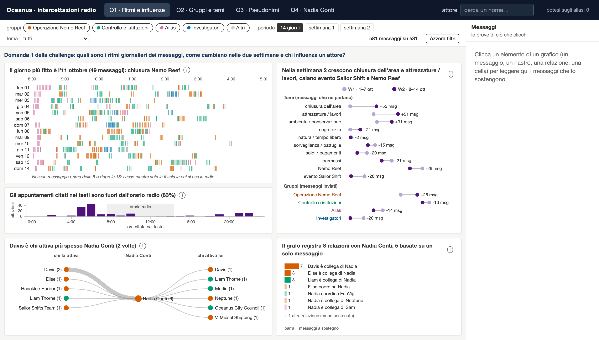
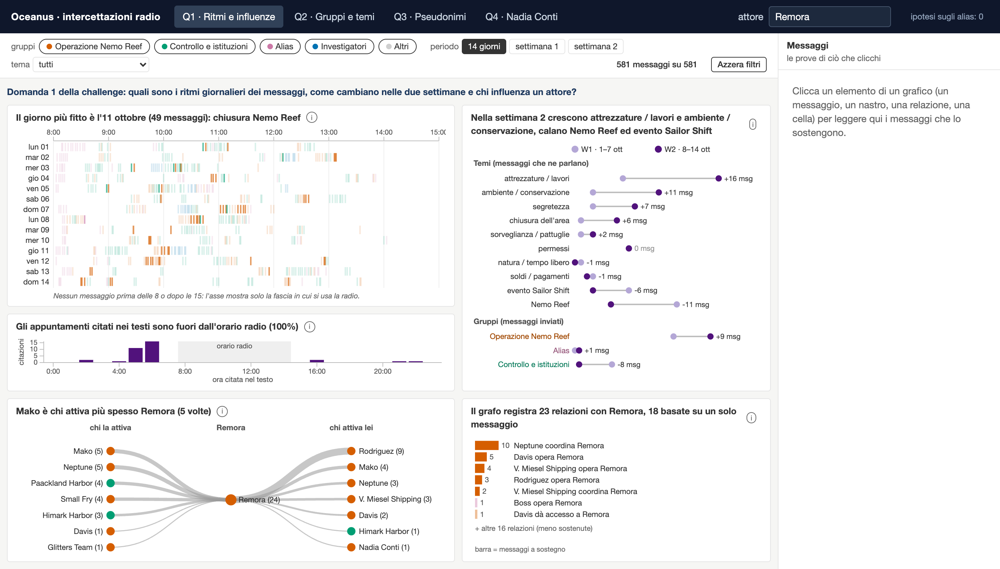
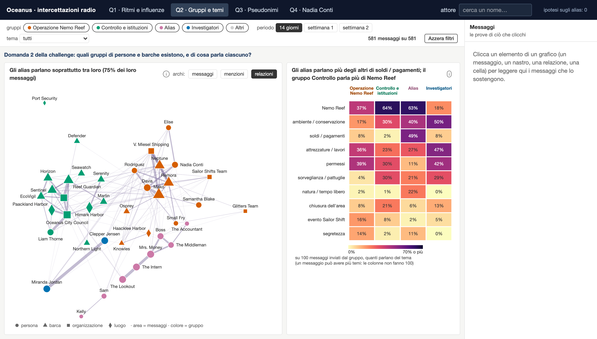
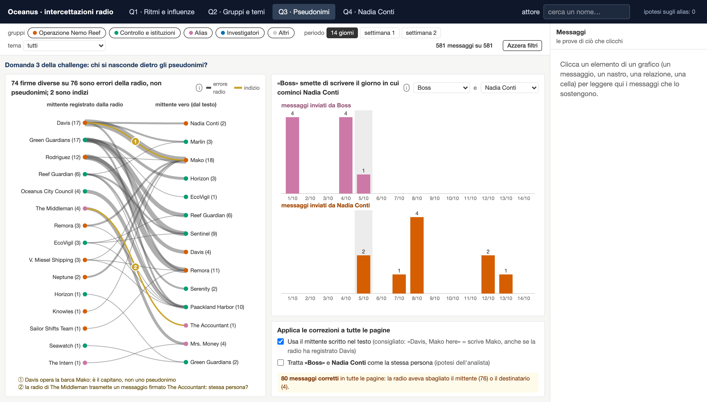
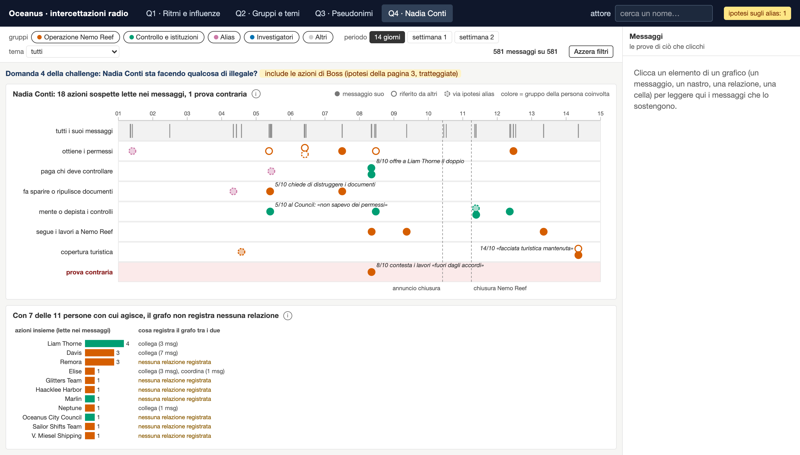
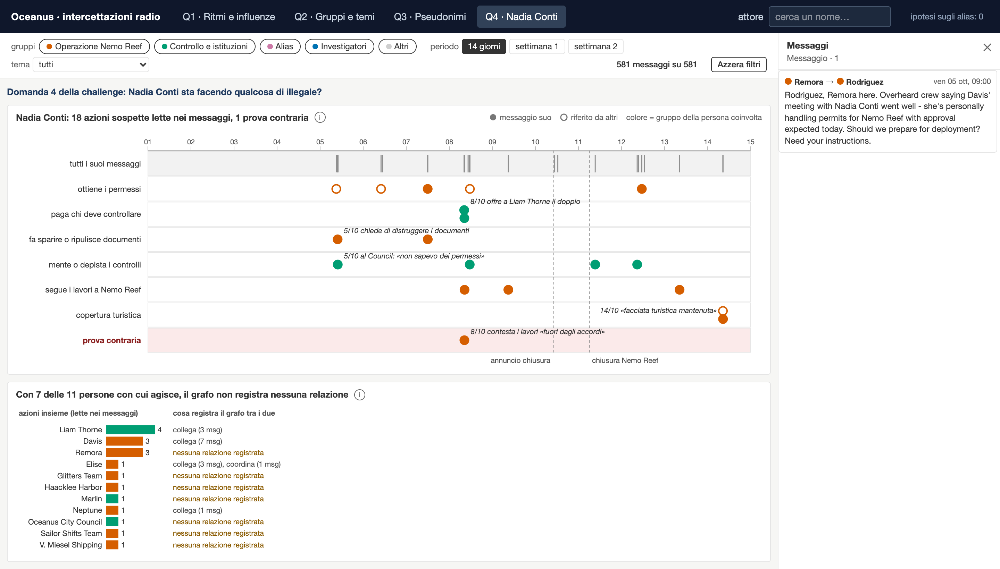

# Oceanus — Visual Analytics per la VAST Challenge 2025, Mini-Challenge 3

Strumento di analisi visuale per le comunicazioni radio di Oceanus (VAST Challenge 2025, MC3).
Aiuta un analista a rispondere a quattro domande: ritmi delle comunicazioni e chi influenza chi (Q1),
gruppi e temi (Q2), pseudonimi (Q3), attività di Nadia Conti (Q4).

Progetto d'esame del corso di Visual Analytics (602AA), Università di Pisa.

## Struttura

```
app/        applicazione web (Vue 3 + Vite + D3)
analysis/   notebook di esplorazione dei dati
scripts/    pipeline dei dati (grafo → tabelle → JSON per l'app)
data/       tabelle generate dalla pipeline
docs/       screenshot dell'app
report/     relazione in italiano (relazione_it) e in inglese (report_en), .tex e .pdf; compilare con `tectonic`
```

## Dati

I dati della challenge non sono inclusi. Scaricare `MC3_release.zip` dalla pagina
[VAST Challenge 2025 – MC3](https://vast-challenge.github.io/2025/MC3.html) ed estrarlo nella radice del progetto
(cartella `MC3_release/`).

## Pipeline

```bash
python -m venv .venv && .venv/bin/pip install -r requirements.txt
.venv/bin/python scripts/convert_graph.py     # grafo → data/processed/
.venv/bin/python scripts/clean_data.py        # pulizia → data/clean/
.venv/bin/python scripts/export_app_data.py   # JSON → app/public/data/
```

## Avvio dell'app

```bash
cd app
npm install
npm run dev
```

## Le quattro pagine

Una pagina per domanda della challenge; l'attore scelto in alto e i filtri (gruppi, periodo, tema) valgono per tutte.
I testi dei messaggi compaiono nel pannello a destra quando si clicca un elemento: sono la prova di ciò che si vede.

- **Q1 · Ritmi e influenze**: calendario dei messaggi (giorni × ore 8–15), cosa cambia tra la prima e la seconda
  settimana per tema e per gruppo, ore citate nei testi, chi «attiva» l'attore scelto (catene di messaggi entro 15
  minuti) e i ruoli che il grafo registra su di lui.
- **Q2 · Gruppi e temi**: grafo dei 40 attori con i gruppi a zone (tre tipi di archi sulle stesse posizioni: messaggi,
  menzioni, relazioni del grafo) e la quota di messaggi di ogni gruppo per tema.
- **Q3 · Pseudonimi** (vista originale in D3): chi ha davvero inviato il messaggio — in 76 messaggi la radio registra
  un mittente diverso da chi scrive, quasi sempre il destinatario; messaggi inviati giorno per giorno da un alias e da un
  candidato (es. Boss smette di scrivere il giorno in cui comincia Nadia Conti); le correzioni e le ipotesi scelte qui (es. Boss = Nadia Conti) ridisegnano tutte le altre pagine.
- **Q4 · Nadia Conti**: cosa fa e quando (azioni codificate dai testi, prove dirette e riferite, prova contraria) e con
  chi, confrontato con ciò che registra il grafo.

## Screenshot

| | |
|---|---|
|  Q1 · ritmi |  Q1 · chi influenza Remora |
|  Q2 · relazioni del grafo |  Q3 · mittenti veri |
|  Q4 con l’ipotesi Boss = Nadia |  Q4 · azioni di Nadia |
